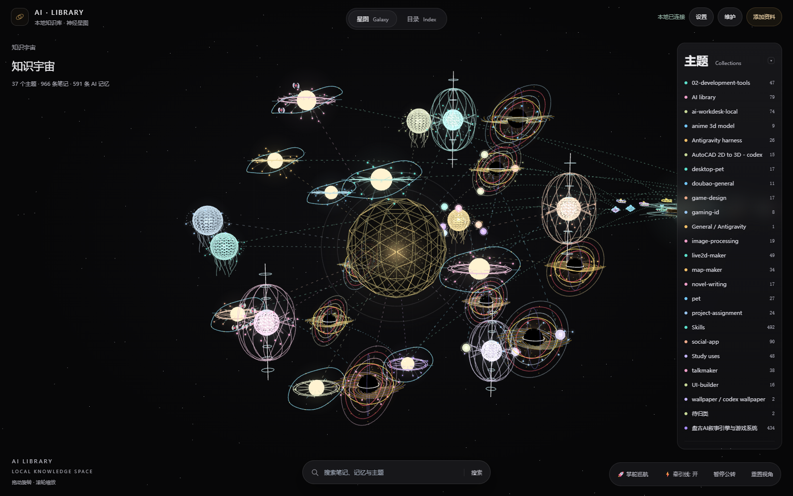
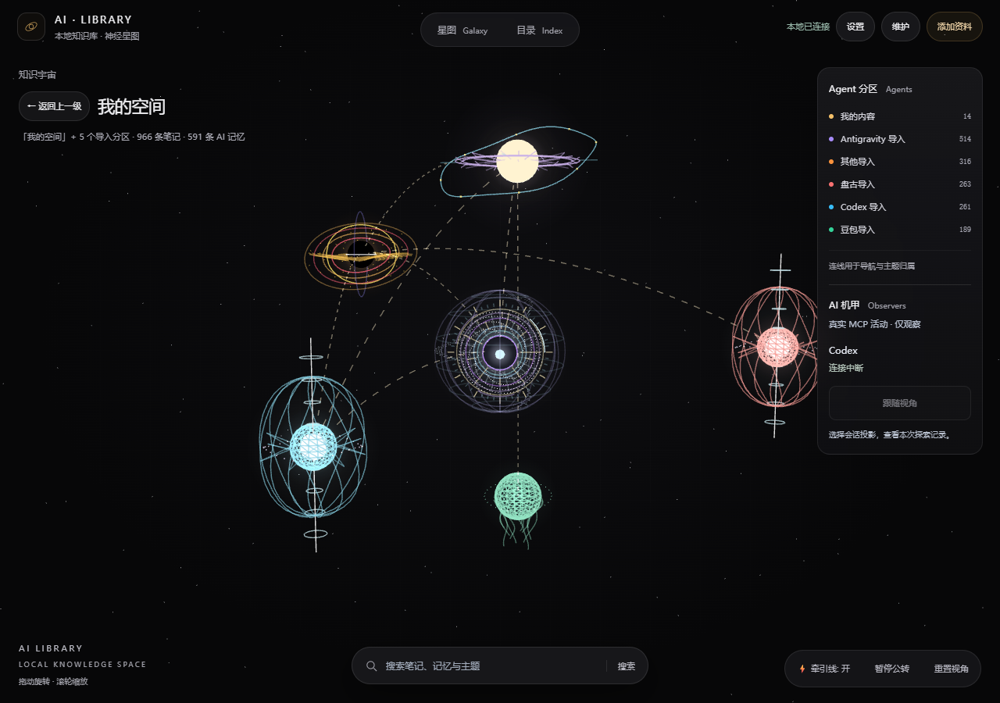
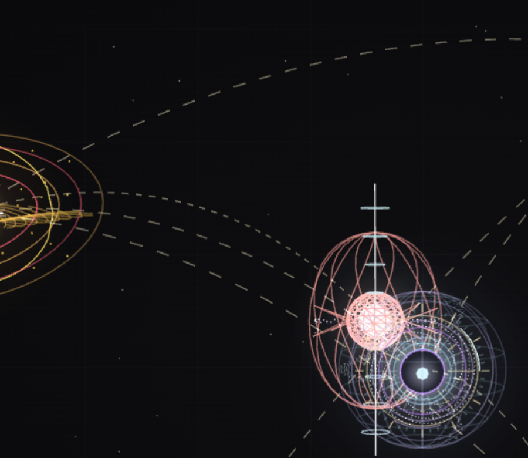

# 🌌 AI Knowledge OS (AI Library)

<p align="center">
  <b>A Local-First 3D Epistemic Knowledge Operating System & Memory Gateway for Humans & Autonomous AI Agents.</b><br>
  面向人类与多智能体的本地优先、3D 星际认知知识操作系统与长效记忆网关。
</p>

<p align="center">
  <a href="#-english">English</a> • <a href="#-简体中文">简体中文</a>
</p>

<p align="center">
  <a href="LICENSE"></a>
  
  
  
  
</p>

---

## 📸 Visual Showcase / 视觉盛宴

<p align="center">
  
  <br>
  <em>🌌 3D Celestial Knowledge Universe: Topics as Radiant Suns, Notes & Memories as Orbiting Planets / 3D 天体宇宙星系：主题为恒星，笔记与记忆为环绕行星</em>
</p>

<p align="center">
  
  
  <br>
  <em>🕷️ Spider-Mecha Cybernetic Inspector & Deep Orbital Fleet Formations / 机甲探针巡检系统与深空轨道舰队</em>
</p>

---

<a name="-english"></a>
## 🌐 English

### 🌟 What is AI Knowledge OS?

Most "AI second brains" are just flat markdown folders or uncurated vector databases that devolve into digital junk drawers. **AI Knowledge OS** reimagines your knowledge base as a **living, breathing 3D cosmos**:

- ☀️ **Central Suns**: Primary topic clusters, domains, and research horizons.
- 🪐 **Orbiting Planets**: Atomic human notes, imported chat transcripts, and verified memory cores.
- 🛸 **Fleet Battlegroups & Space Stations**: Autonomous agents, active MCP connections, and tooling constellations.
- 🕷️ **Spider-Mecha Cybernetic Probe**: Real-time 3D inspection walker that crawls your knowledge graph to audit node revisions, verify citations, and detect cognitive contradictions.

---

### 🚀 Key Highlights

1. **Epistemic Truth Governance**:
   - Strict separation of **human notes** (immutable ground truth), **imported sources** (raw evidence), and **AI inferred memories** (probabilistic hypotheses).
   - Candidate staging lifecycle (`list_candidates` ➜ `accept_candidate`) prevents hallucinated agent conclusions from corrupting canonical memory.

2. **Hybrid RRF Retrieval**:
   - Blends SQLite **FTS5 BM25** keyword search with **dense vector embeddings** using Reciprocal Rank Fusion (RRF).

3. **Universal MCP Protocol (Stdio & SSE)**:
   - Connects seamlessly to **Claude Desktop**, **Cursor**, **Antigravity**, **WorkBuddy**, and custom agent frameworks.

4. **DeepSeek Harness (DSH) Native Integration**:
   - Ships with an out-of-the-box `@ling/ai-library-harness` Cordis bundle.
   - **Dynamic Island (灵动岛)**: Floating HUD pill for effortless topic switching, connection health monitoring, and mecha inspection.
   - **Zero-Latency Evidence Injection**: Injects verified, source-attributed memory snapshots into the prompt waterfall *before* model token generation without extra MCP roundtrips.

---

### ⚡ Quick Start

#### 1. Setup Environment
```bash
git clone https://github.com/lingjw02/ai-library.git
cd ai-library

# Recommended: ultra-fast sync via uv
uv sync

# Or using standard pip
python -m venv .venv
source .venv/bin/activate  # On Windows: .venv\Scripts\activate
pip install -e .
```

#### 2. Initialize Database & Launch Server
```bash
# Initialize empty knowledge database from canonical schema
python scripts/manage_snapshots.py --init

# Start FastAPI backend & 3D Web UI
python -m uvicorn backend.adapters.api.app:app --host 127.0.0.1 --port 8000 --reload
```
Open **`http://127.0.0.1:8000`** in Chrome/Edge to explore your 3D Knowledge Universe.

---

### 🤖 DeepSeek Harness (DSH) Setup

AI Knowledge OS includes a dedicated Cordis Host bundle in [`plugins/deepseek-harness-ai-library`](plugins/deepseek-harness-ai-library):

1. In your **DeepSeek Harness** chat prompt, paste:
   ```text
   Please install the local bundle:
   D:/02_Development_Tools/ai-library/plugins/deepseek-harness-ai-library
   Enable the bundle and verify the application status.
   ```
2. The **AI LIBRARY Dynamic Island** will appear at the top center of the Harness UI.
3. Switch topics, view live Spider-Mecha telemetry, and enjoy autonomous context injection without burning model tool steps.

---

### 🔌 Standard MCP Client Configuration

#### Claude Desktop
Add to your `claude_desktop_config.json`:
```json
{
  "mcpServers": {
    "ai-memory-library": {
      "command": "python",
      "args": ["-m", "backend.adapters.mcp.stdio_server"],
      "cwd": "/path/to/ai-library"
    }
  }
}
```

---

<a name="-简体中文"></a>
## 🇨🇳 简体中文

### 🌟 什么是 AI Knowledge OS？

传统的所谓“AI 第二大脑”大多只是扁平的 Markdown 文件夹或缺乏治理的向量库，随着时间推移极易沦为混乱的“数字垃圾场”。**AI Knowledge OS** 将知识体系升华为**鲜活运转的 3D 星际宇宙**：

- ☀️ **中心恒星（Suns）**：核心主题领域、研究方向与知识聚类。
- 🪐 **环绕行星（Planets）**：原子化的人类笔记、跨端会话源文件、以及经过严谨验证的长期记忆核心。
- 🛸 **星际舰队与空间站**：巡航中的 AI 智能体、活跃的 MCP 连接通道与工具护航舰队。
- 🕷️ **机甲探针（Spider-Mecha）**：穿梭于 3D 节点之间的赛博机甲，深入知识网络拓扑，执行版本追溯、引文对齐与认知冲突审计。

---

### 💎 核心技术特性

1. **认知防污染治理（Epistemic Governance）**：
   - 严格区分**人类笔记**（不可篡改的事实基石）、**原始资料源**（完整证据链）与 **AI 推理记忆**（待审假设）。
   - 独创候选记忆生命周期机制（`list_candidates` ➜ `accept_candidate`），彻底杜绝幻觉记忆污染正式库。

2. **BM25 + 向量 RRF 混合检索**：
   - 基于 SQLite 原生 **FTS5 BM25** 关键词索引与稠密向量索引，采用倒数排名融合（RRF）算法，兼顾精准匹配与语义关联。

3. **全生态 MCP 协议支持（Stdio / SSE）**：
   - 原生支持 **Claude Desktop**、**Cursor**、**Antigravity**、**WorkBuddy** 等主流智能体环境。

4. **DeepSeek Harness（DSH）原生无感注入**：
   - 内置经过实测验证的 `@ling/ai-library-harness` Cordis 插件。
   - **悬浮灵动岛（Dynamic Island）**：窗口顶部胶囊控制台，可随时收起/展开，实时查看连接主题、切换探索领域、监视机甲观察。
   - **Pre-Step 瀑布流极速注入**：在模型处理用户输入之前，自动读取使用规则并检索获准资料注入证据快照，无需模型手动逐轮调用检索工具，极大节省 Token 与耗时。
   - **智能星图拓扑开辟**：自动计算会话关键词与星图天体的语义亲和度，支持一键在 3D 宇宙中开辟新主题天体。

---

### ⚡ 极速上手

#### 1. 配置环境
```bash
git clone https://github.com/lingjw02/ai-library.git
cd ai-library

# 推荐使用现代极速包管理器 uv
uv sync

# 或者使用常规 pip
python -m venv .venv
# Windows: .venv\Scripts\activate
# Linux/macOS: source .venv/bin/activate
pip install -e .
```

#### 2. 初始化数据库并启动
```bash
# 从规范 schema 初始化空知识库
python scripts/manage_snapshots.py --init

# 启动 FastAPI 后端服务与 3D 宇宙界面
python -m uvicorn backend.adapters.api.app:app --host 127.0.0.1 --port 8000 --reload
```
在浏览器中打开 **`http://127.0.0.1:8000`**，即可沉浸式探索您的 3D 知识星系！

---

### 🤖 DeepSeek Harness（DSH）接入说明

AI Knowledge OS 在 [`plugins/deepseek-harness-ai-library`](plugins/deepseek-harness-ai-library) 中提供了原生 Cordis Host bundle：

1. 在 **DeepSeek Harness** 对话框中发送：
   ```text
   请安装本地插件 bundle：
   D:/02_Development_Tools/ai-library/plugins/deepseek-harness-ai-library
   启用该 bundle 并检查应用状态。
   ```
2. 窗口顶部正中将弹出 **AI LIBRARY 灵动岛** 胶囊。
3. 您可以自由切换知识主题、查看机甲探针的实时观测视口，并在对话中自动获得高可信度的知识注入。

---

### 📁 仓库代码架构

```text
ai-library/
├── backend/                   # Python FastAPI 微内核与 MCP 服务端
│   ├── adapters/              # MCP (stdio/sse)、REST API 与 Harness 适配器
│   ├── core/                  # RRF 混合检索、证据包聚合与图遍历
│   ├── candidates/            # 候选记忆生命周期管理与审查引擎
│   ├── conflicts/             # 认知冲突智能检测与裁决工作流
│   └── storage/               # SQLite 规范存储与原始数据管理
├── frontend/                  # WebGL 3D 宇宙可视化前端
│   ├── index.html             # 3D 视口、星空穹顶与 HUD 控制面板
│   ├── js/                    # Three.js 天体轨道运动学与机甲探针控制器
│   └── assets/                # Procedural & GLTF 天体模型资产
├── plugins/                   # 宿主集成插件
│   └── deepseek-harness-ai-library/ # DSH 专属灵动岛与上下文桥接插件
├── scripts/                   # 启动器构建、迁移索引与运维脚本
├── tests/                     # 完整的自动化单元测试与端到端测试
└── README.md                  # 项目中英双语主页
```

---

## 📜 许可证 / License

本项目采用 [MIT 许可证](LICENSE)。欢迎全球开发者与研究者共同构建新一代开源 AI 知识操作系统！
